<div align="center">

# SENTINELA AI

**From Evidence to Intelligence.**

[](README.md)
[](README.pt.md)

**Technical Dossier & Operational Intelligence Platform Specification**

</div>

---

## Table of Contents

1. [Problem Statement & Alignment](#1-problem-statement--alignment)
2. [System Architecture](#2-system-architecture)
3. [Visual Tour & Interface Elements](#3-visual-tour--interface-elements)
4. [Core Modules & Deterministic Engines](#4-core-modules--deterministic-engines)
5. [API Reference Summary](#5-api-reference-summary)
6. [Security, Governance & Accessibility](#6-security-governance--accessibility)
7. [Repository Structure](#7-repository-structure)
8. [Demo Account & Vercel Standalone Mode](#8-demo-account--vercel-standalone-mode)
9. [Local Setup & Testing](#9-local-setup--testing)

---

## 1. Problem Statement & Alignment

Organizations operating in high-accountability environments (public administration, corporate security, compliance, and critical infrastructure) face three recurring operational bottlenecks:

| Operational Challenge | SENTINELA AI Engineering Solution |
| :--- | :--- |
| **Fragmented records** across disconnected tools | Unified multi-tenant workspace linking incidents, documents, evidence, risk assessments, recommendations, tasks, and audit logs. |
| **Opaque AI outputs** with fabricated scores | Evidence-bound RAG citations (`page_number`, `chunk_index`, `score`), explicit AI unavailability states, and deterministic risk scoring (`0-100`). |
| **Weak auditability** and unreviewed actions | Mandatory human-in-the-loop approval for recommendations, RBAC enforcement per organization, and automatic audit trail logging. |

---

## 2. System Architecture

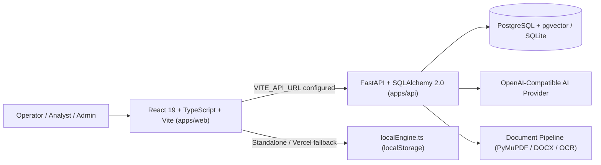

| Layer | Technology | Responsibility |
| :--- | :--- | :--- |
| **Frontend** | React 19, TypeScript, Vite 8, Tailwind CSS 4 | Responsive Command Center, Landing, Auth, and 10 Operational Modules |
| **Data & State** | TanStack React Query, Axios | Caching, document polling, automatic JWT refresh queue, standalone fallback |
| **Visualizations** | Recharts + Custom 5x5 Matrix | 7-day trend (`AreaChart`), severity (`BarChart`), status (`PieChart`), 5x5 Risk Matrix |
| **Backend API** | FastAPI, SQLAlchemy 2.0, Pydantic v2 | Multi-tenant REST API (`/api/v1`), RBAC dependency guards, OpenAPI `/docs` |
| **Persistence** | PostgreSQL + pgvector (SQLite for local/test) | Relational domain records and vector embeddings |
| **Security** | JWT (Access + Refresh), bcrypt, ASGI Middleware | HTTP security headers, `X-Organization-ID` isolation, CSV formula neutralization |

---

## 3. Visual Tour & Interface Elements

### 3.1 Landing Page (`/`)
Obsidian dark aesthetic (`#050607`), animated brand emblem, bilingual switcher (`EN / PT`), capability strip, 4-stage workflow (`Ingest -> Extract -> Analyze -> Decide`), 10-module overview, security guarantees, and FAQ.

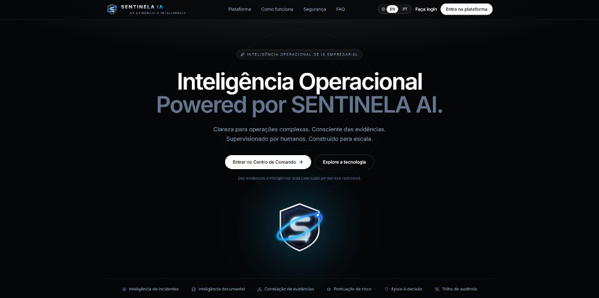

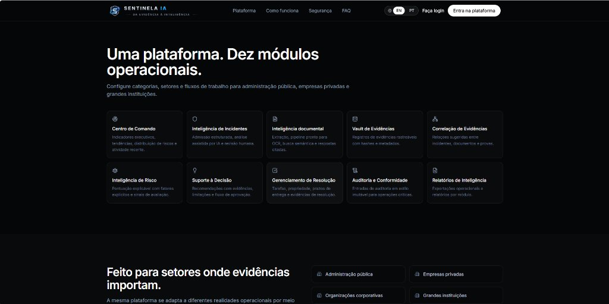

### 3.2 Authentication Shell (`/login`, `/register`, `/forgot-password`, `/reset-password`)
Split-panel obsidian glassmorphism layout with password visibility toggle, form validation, subtle one-click `Demo` autofill button, and full bilingual support.

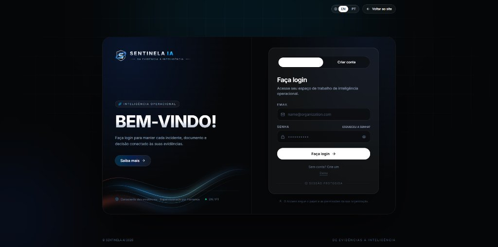

### 3.3 Command Center (`/app`)
Static obsidian sidebar (`lg:sticky lg:top-0 lg:h-screen`), organization and role context header (`Espaço de Trabalho / Sentinela Global Ops · Super Admin`), 8 executive KPI cards, 3 interactive charts (7-day trend, severity, status), recent activity feed, and one-click authenticated CSV exports.

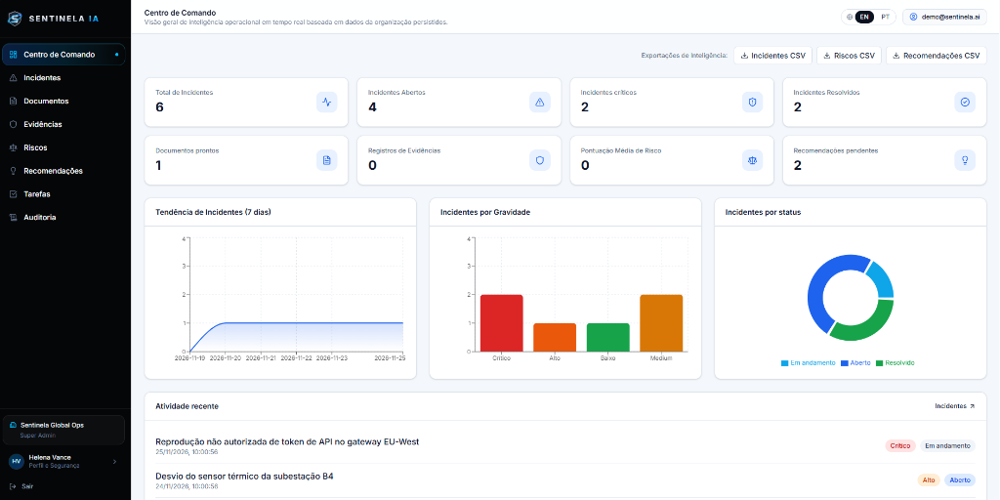

### 3.4 Incident Intelligence (`/app/incidents`)
Structured incident intake form, real-time filtering (`search`, `status`, `severity`), inline status transitions (`open`, `in_progress`, `resolved`, `closed`), and AI-assisted structured triage with explicit missing-information and next-step extraction.

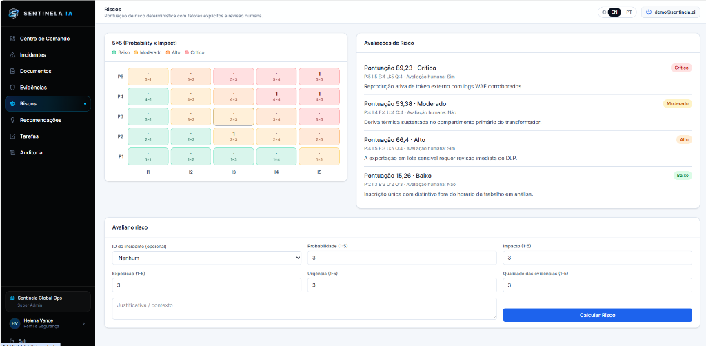

### 3.5 Risk Intelligence & 5x5 Matrix (`/app/risks`)
Interactive **5x5 Risk Matrix** (`Probability 5..1` x `Impact 1..5`) positioned side by side with filtered risk assessments, color-coded severity zones, click-to-select matrix coordinates, and deterministic 5-factor scoring.


### 3.6 Document Intelligence, Evidence, Recommendations, Tasks & Audit
- **Documents (`/app/documents`)**: PDF/DOCX/TXT ingestion with `SHA-256` verification, automatic polling, and cited RAG Q&A.
- **Evidence & Correlation (`/app/evidence`)**: Evidence vault linked to real incidents with cross-incident correlation suggestions.
- **Recommendations (`/app/recommendations`)**: Human approve/reject workflow with review notes and status filtering.
- **Tasks (`/app/tasks`) & Audit (`/app/audit`)**: Actionable remediation tasks and filterable audit logs.

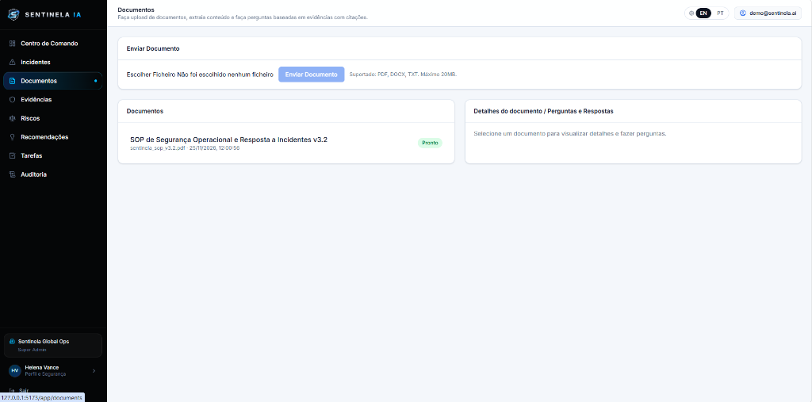

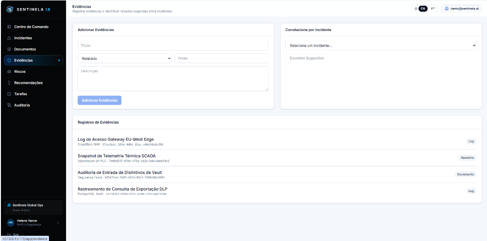

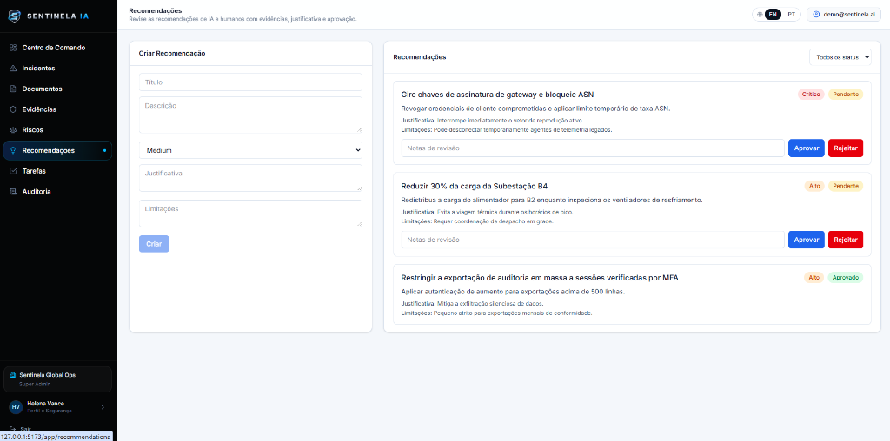

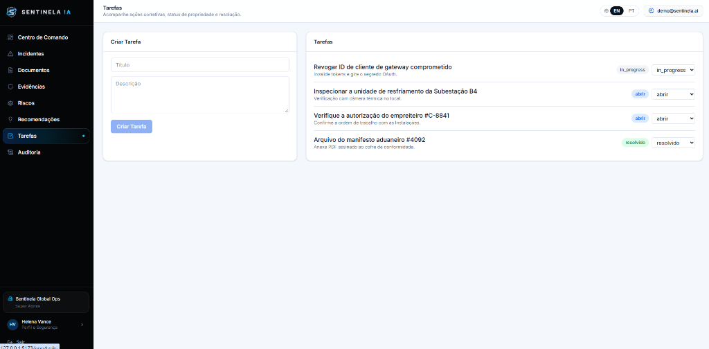

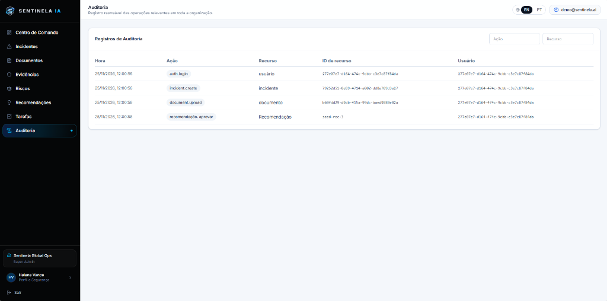

### 3.7 Profile & Security (`/app/profile`)
Centered executive profile banner with initials avatar, role/status badges, personal identity editor (`PATCH /auth/me`), password updater with strength meter (`POST /auth/change-password`), active organization RBAC permission pills, and secure session termination.


---

## 4. Core Modules & Deterministic Engines

1. **Document Intelligence (`/app/documents`)**: Uploads `PDF`, `DOCX`, and `TXT`, computes `SHA-256` hash, polls processing state automatically (`uploaded` -> `processing` -> `ready`), and answers questions with page, chunk, and similarity score citations.
2. **Evidence Vault & Correlation (`/app/evidence`)**: Links evidence (`report`, `photo`, `document`, `testimony`, `log`, `other`) to real organization incidents and computes cross-incident correlation suggestions via deterministic token/category/location overlap.
3. **Deterministic Risk Formula**:
   $$\text{Score} = \text{round}\left(\frac{0.25P + 0.30I + 0.15E + 0.15U + 0.15Q}{5} \times 100\right)$$
   - `critical` ($\ge 75$), `high` ($\ge 55$), `moderate` ($\ge 35$), `low` ($< 35$).
   - `requires_human_review = True` whenever `evidence_quality <= 2` or `level in {"high", "critical"}`.
4. **Decision Support (`/app/recommendations`)**: Human approve/reject workflow with mandatory review notes and status filtering.
5. **Resolution Tasks (`/app/tasks`) & Audit Trail (`/app/audit`)**: Trackable remediation tasks and filterable audit logs (`action`, `resource_type`).

---

## 5. API Reference Summary

| Domain | Key Endpoints |
| :--- | :--- |
| **Auth & Profile** | `POST /auth/register`, `POST /auth/login`, `POST /auth/refresh`, `GET /auth/me`, `PATCH /auth/me`, `POST /auth/change-password`, `POST /auth/logout` |
| **Incidents** | `GET /incidents`, `POST /incidents`, `PATCH /incidents/{id}`, `POST /incidents/{id}/analyze`, `GET /incidents/{id}/analysis` |
| **Documents** | `GET /documents`, `POST /documents/upload`, `POST /documents/{id}/analyze`, `POST /documents/{id}/questions` |
| **Evidence & Risk** | `GET /evidence`, `POST /evidence`, `POST /evidence/correlate`, `GET /risks`, `POST /risks/assess` |
| **Decisions & Tasks** | `GET /recommendations`, `POST /recommendations`, `POST /recommendations/{id}/approve\|reject`, `GET/POST /tasks`, `PATCH /tasks/{id}` |
| **Analytics & Audit** | `GET /analytics/overview`, `GET /reports/incidents.csv\|risks.csv\|recommendations.csv`, `GET /audit` |

---

## 6. Security, Governance & Accessibility

- **Multi-Tenant Isolation**: Every workspace call requires `X-Organization-ID` validated against active `Membership` records.
- **RBAC Roles**: `Super Admin`, `Organization Admin`, `Manager`, `Analyst`, `Operator`, `Viewer` enforced at FastAPI dependency level.
- **ASGI Security Headers**: `X-Content-Type-Options: nosniff`, `X-Frame-Options: DENY`, `Referrer-Policy: strict-origin-when-cross-origin`, `Permissions-Policy`.
- **CSV Injection Defense**: Cells starting with `=`, `+`, `-`, `@`, `\t`, or `\r` are escaped with a leading apostrophe.
- **Accessibility**: Semantic landmarks, skip-to-content link, `:focus-visible` outlines, `aria-label` on form controls, responsive mobile navigation drawer (`aria-expanded`, `aria-controls`), and dynamic `<html lang>` switching.

---

## 7. Repository Structure

```text
sentinela-ai/
  apps/
    api/
      app/
        ai/              # AI provider abstraction & OpenAI adapter
        api/             # JWT/org/RBAC dependencies and v1 endpoints
        core/            # Settings, password hashing, JWT, localization
        db/              # SQLAlchemy base, session, portable types, demo seed
        models/          # Relational & vector models
        schemas/         # Pydantic v2 contracts
        services/        # Risk engine, document extraction, audit, mailer, storage
      tests/             # Unit & end-to-end API workflow tests
    web/
      src/
        components/      # UI primitives, AuthShell, AppLayout, Logo
        lib/             # Axios client (refresh + local fallback), AuthProvider, i18n
        pages/           # Public & /app/* operational pages
      vercel.json        # SPA rewrite rules
  docs/
    screenshots/         # Real application screenshots
  docker-compose.yml
  vercel.json
  .env.example
```

---

## 8. Demo Account & Vercel Standalone Mode

Both the backend seed (`apps/api/app/db/seed_demo.py`) and the client-side engine (`apps/web/src/lib/localEngine.ts`) provide a pre-populated Demo Account:

- **Email**: `demo@sentinela.ai`
- **Password**: `SentinelaDemo2026!`
- **Quick Fill**: Click the subtle `Demo` button on `/login` to auto-fill credentials.

When deployed to **Vercel** without an external `VITE_API_URL`, SENTINELA AI automatically activates `localEngine.ts` (`localStorage`), keeping account registration, login, demo data, and full module CRUD operational.

---

## 9. Local Setup & Testing

```bash
# 1. Configure environment
cp .env.example .env
cp apps/web/.env.example apps/web/.env

# 2. Backend (apps/api)
cd apps/api
python -m venv .venv
# Windows: .venv\Scripts\activate | Linux/macOS: source .venv/bin/activate
pip install -e ".[dev]"
python -m unittest discover -s tests -v
uvicorn app.main:app --reload --port 8000

# 3. Frontend (apps/web)
cd apps/web
npm install
npm run lint
npm run build
npm run dev
```
