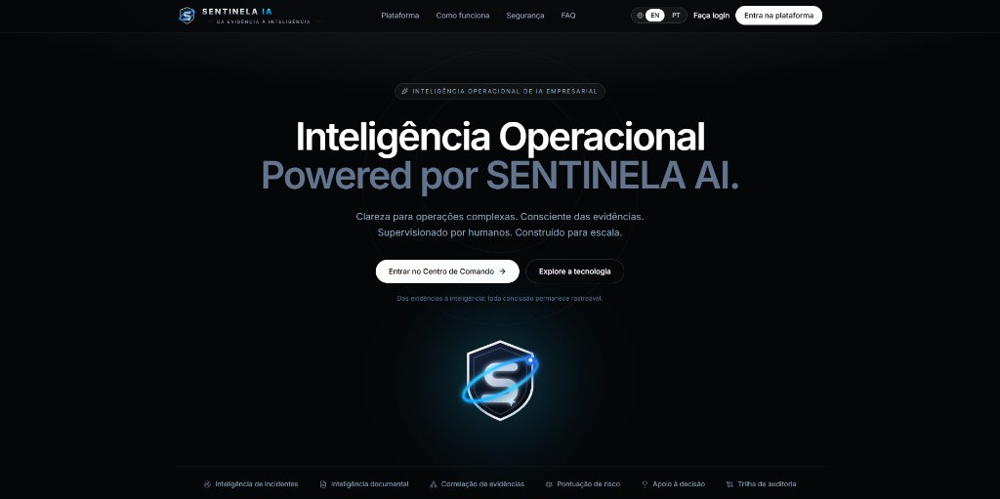
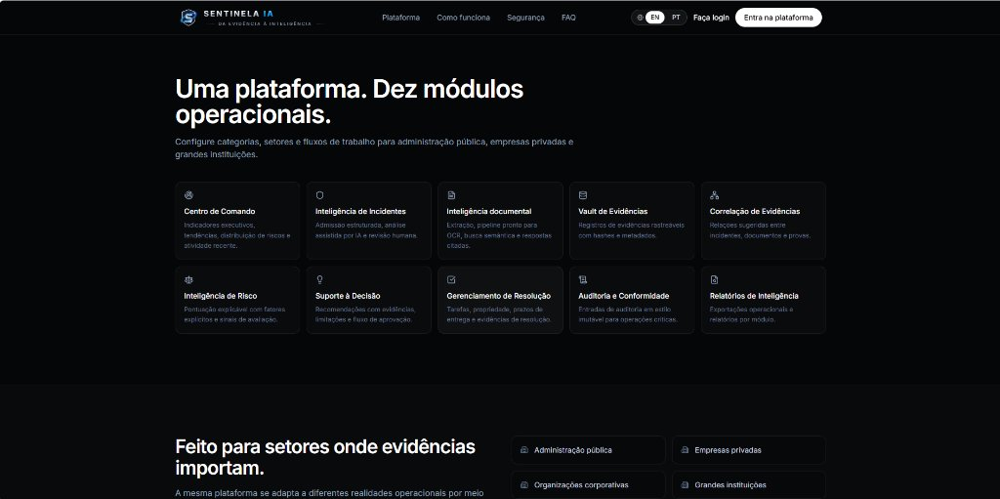
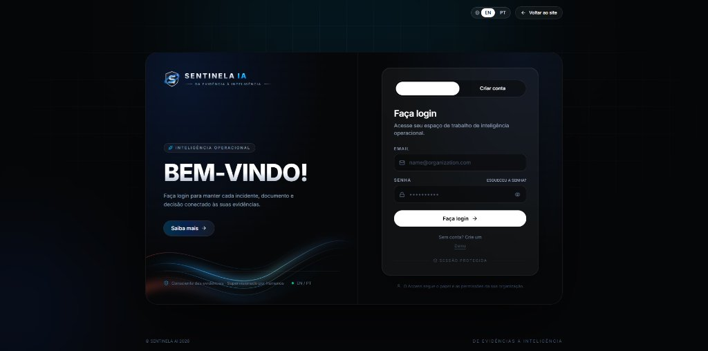
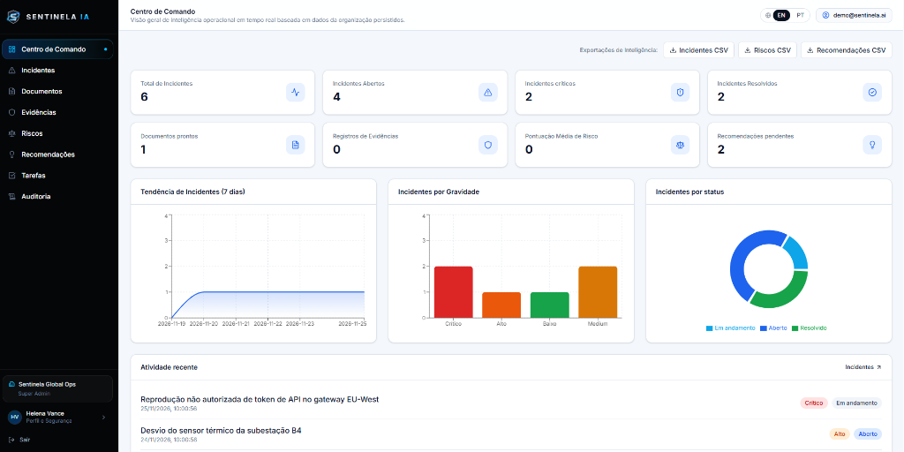
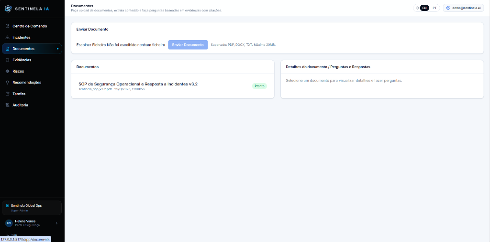
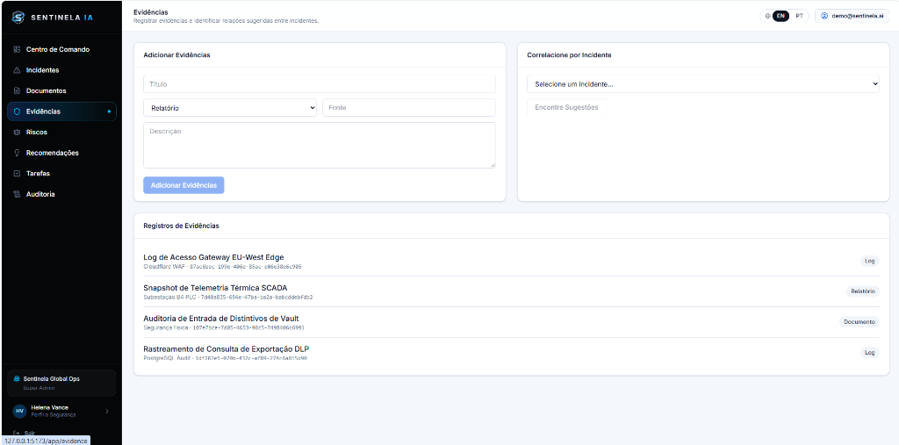
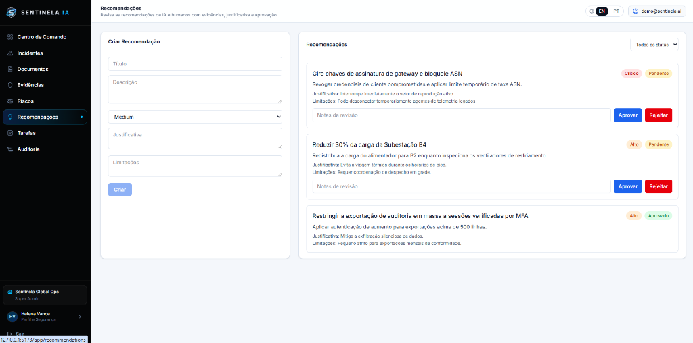
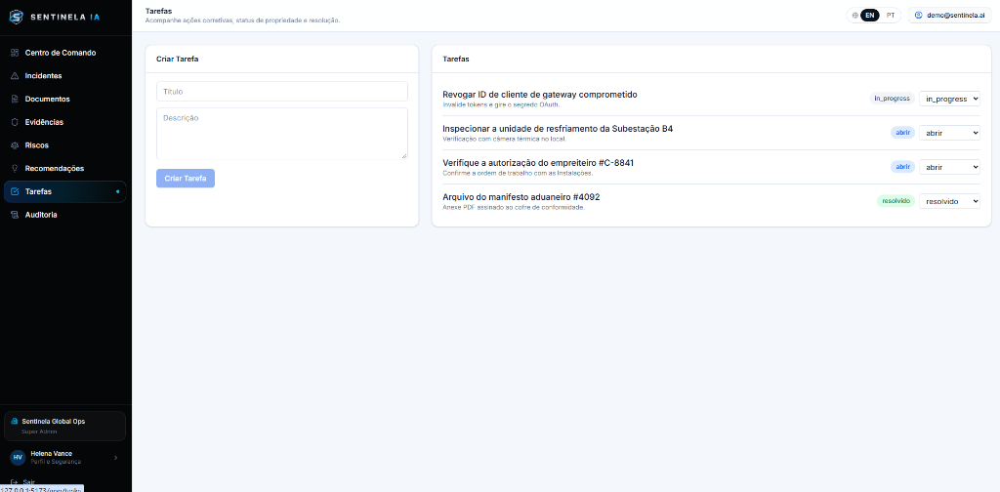
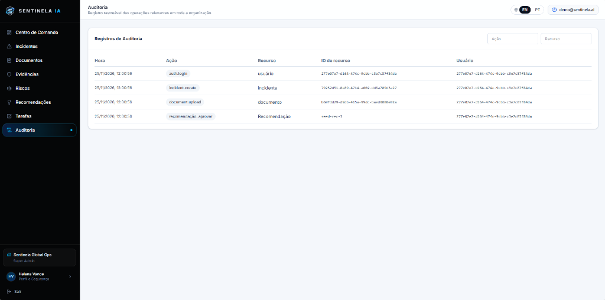
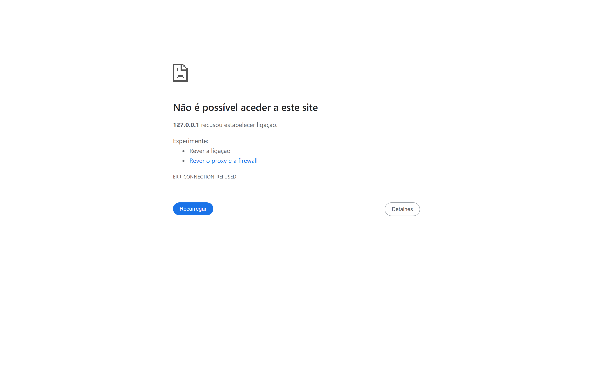

<div align="center">

# SENTINELA AI

**Da Evidência à Inteligência.**

[](README.md)
[](README.pt.md)

**Caderno Técnico e Especificação da Plataforma de Inteligência Operacional**

</div>

---

## Índice

1. [Declaração do Problema e Alinhamento](#1-declaração-do-problema-e-alinhamento)
2. [Arquitetura do Sistema](#2-arquitetura-do-sistema)
3. [Tour Visual e Elementos da Interface](#3-tour-visual-e-elementos-da-interface)
4. [Módulos Principais e Motores Determinísticos](#4-módulos-principais-e-motores-determinísticos)
5. [Resumo da API](#5-resumo-da-api)
6. [Segurança, Governança e Acessibilidade](#6-segurança-governança-e-acessibilidade)
7. [Estrutura do Repositório](#7-estrutura-do-repositório)
8. [Conta Demo e Modo Standalone na Vercel](#8-conta-demo-e-modo-standalone-na-vercel)
9. [Instalação Local e Testes](#9-instalação-local-e-testes)

---

## 1. Declaração do Problema & Alinhamento

### O Problema
Organizações em ambientes de alta responsabilidade (administração pública, segurança corporativa, compliance, infraestruturas críticas) enfrentam: **registos fragmentados** em ferramentas desconectadas; **outputs de IA opacos** que fabricam pontuações ou escondem evidências; e **fraca auditabilidade** onde decisões carecem de revisão humana e registos rastreáveis.

### Como o SENTINELA AI Resolve

| Desafio Operacional | Solução SENTINELA AI | Onde no sistema |
| :--- | :--- | :--- |
| **Registos fragmentados** | Espaço multi-tenant unificado ligando incidentes, documentos, evidências, risco, recomendações, tarefas e auditoria. | Command Center /app, 10 módulos, API com escopo X-Organization-ID |
| **IA opaca/não verificável** | Q&A documental com citações (page_number, chunk_index, score, excerto), estado explícito AI unavailable (nunca fabricado), risco determinístico (0–100). | /app/documents, POST /documents/{id}/questions, POST /risks/assess |
| **Fraca auditabilidade / decisões sem revisão** | Aprovação/rejeição humana obrigatória para recomendações, RBAC por organização, trilha de auditoria automática, exportações CSV. | /app/recommendations, /app/audit, /reports/*.csv, RBAC |

### Alinhamento Mensurável
- **Rastreabilidade**: cada resposta documental inclui citações com página, chunk, score e excerto.
- **Sem IA fabricada**: sem provider, o sistema retorna estado indisponível + referências recuperadas.
- **Risco determinístico**: score = round((0.25P + 0.30I + 0.15E + 0.15U + 0.15Q)/5*100); 
equires_human_review = true quando qualidade da evidência ≤ 2 ou nível high/critical.
- **Supervisão humana**: recomendações exigem aprovar/rejeitar com notas; ações registadas em auditoria.
- **Bilingue e acessível**: EN/PT completo, skip link, focus-visible, ARIA, landmarks.
- **Segurança**: JWT access+refresh, RBAC, isolamento por organização, headers de segurança, rate limit auth, defesa CSV injection, reset com token hash/uso único/expiração.

--- | :--- |
| **Registos fragmentados** em ferramentas isoladas | Espaço multi-tenant unificado ligando incidentes, documentos, evidências, avaliações de risco, recomendações, tarefas e auditoria. |
| **Respostas de IA opacas** com pontuações inventadas | Citações RAG ligadas a evidências (`page_number`, `chunk_index`, `score`), estados explícitos de indisponibilidade de IA e pontuação de risco determinística (`0-100`). |
| **Auditabilidade fraca** sem supervisão | Aprovação humana obrigatória para recomendações, controlo RBAC por organização e trilha de auditoria automática. |

---

## 2. Arquitetura do Sistema


| Camada | Tecnologia | Responsabilidade |
| :--- | :--- | :--- |
| **Frontend** | React 19, TypeScript, Vite 8, Tailwind CSS 4 | Command Center responsivo, Landing, Autenticação e 10 Módulos Operacionais |
| **Estado e Dados** | TanStack React Query, Axios | Cache, polling de documentos, fila de refresh JWT automática e fallback local |
| **Visualizações** | Recharts + Matriz 5x5 Interativa | Tendência de 7 dias (`AreaChart`), severidade (`BarChart`), estado (`PieChart`), Matriz 5x5 |
| **Backend API** | FastAPI, SQLAlchemy 2.0, Pydantic v2 | API REST multi-tenant (`/api/v1`), controlo RBAC, documentação OpenAPI `/docs` |
| **Persistência** | PostgreSQL + pgvector (SQLite para local/testes) | Modelos relacionais e embeddings vetoriais |
| **Segurança** | JWT (Access + Refresh), bcrypt, Middleware ASGI | Headers de segurança HTTP, isolamento `X-Organization-ID`, proteção CSV injection |

---

## 3. Tour Visual e Elementos da Interface

### 3.1 Landing Page (`/`)
Estética dark obsidian (`#050607`), emblema animado da marca, seletor bilíngue (`EN / PT`), barra de capacidades, fluxo de 4 etapas (`Ingerir -> Extrair -> Analisar -> Decidir`), visão dos 10 módulos, garantias de segurança e FAQ.





### 3.2 Autenticação (`/login`, `/register`, `/forgot-password`, `/reset-password`)
Layout split-panel em glassmorphism obsidian com alternância de visibilidade da palavra-passe, validação de formulário, botão discreto `Demo` para auto-preenchimento e suporte bilíngue completo.



### 3.3 Command Center (`/app`)
Barra lateral obsidian estática (`lg:sticky lg:top-0 lg:h-screen`), cabeçalho contextual com organização e cargo (`Espaço de Trabalho / Sentinela Global Ops · Super Admin`), 8 cartões de KPI executivos, 3 gráficos interativos (tendência de 7 dias, severidade, estado), atividade recente e exportação CSV autenticada com 1 clique.



### 3.4 Inteligência de Incidentes (`/app/incidents`)
Registo estruturado de incidentes, filtros em tempo real (`pesquisa`, `estado`, `severidade`), atualização inline de estado (`open`, `in_progress`, `resolved`, `closed`) e triagem estruturada assistida por IA com extração de lacunas de informação e próximos passos.


### 3.5 Inteligência de Risco e Matriz 5x5 (`/app/risks`)
**Matriz de Risco 5x5** interativa (`Probabilidade 5..1` x `Impacto 1..5`) posicionada lado a lado com a lista filtrada de riscos, zonas de criticidade por cor, seleção direta por clique na matriz e cálculo determinístico de 5 fatores.


### 3.6 Inteligência Documental, Evidências, Recomendações, Tarefas e Auditoria
- **Documentos (`/app/documents`)**: Ingestão de PDF/DOCX/TXT com integridade `SHA-256`, polling automático e Q&A com citações.
- **Evidências e Correlação (`/app/evidence`)**: Cofre de evidências associado a incidentes reais com sugestões de correlação cruzada.
- **Recomendações (`/app/recommendations`)**: Fluxo humano de aprovação/rejeição com notas de revisão e filtro por estado.
- **Tarefas (`/app/tasks`) e Auditoria (`/app/audit`)**: Gestão de tarefas de resolução e registos de auditoria filtráveis.











### 3.7 Perfil e Segurança (`/app/profile`)
Banner executivo centralizado com avatar de iniciais, badges de estado e cargo RBAC, edição de identidade pessoal (`PATCH /auth/me`), alteração de palavra-passe com indicador de força (`POST /auth/change-password`), pills de permissões RBAC da organização e encerramento de sessão seguro.



---

## 4. Módulos Principais e Motores Determinísticos

1. **Inteligência Documental (`/app/documents`)**: Upload de `PDF`, `DOCX` e `TXT`, cálculo de hash `SHA-256`, polling automático de estado (`uploaded` -> `processing` -> `ready`) e perguntas com citações de página, segmento e pontuação.
2. **Cofre de Evidências e Correlação (`/app/evidence`)**: Associação de evidências (`report`, `photo`, `document`, `testimony`, `log`, `other`) aos incidentes reais da organização e sugestões determinísticas de correlação cruzada.
3. **Fórmula Determinística de Risco**:
   $$\text{Score} = \text{round}\left(\frac{0.25P + 0.30I + 0.15E + 0.15U + 0.15Q}{5} \times 100\right)$$
   - `critical` ($\ge 75$), `high` ($\ge 55$), `moderate` ($\ge 35$), `low` ($< 35$).
   - `requires_human_review = True` sempre que `evidence_quality <= 2` ou `level in {"high", "critical"}`.
4. **Apoio à Decisão (`/app/recommendations`)**: Fluxo humano de aprovação/rejeição com notas obrigatórias de revisão e filtro por estado.
5. **Tarefas de Resolução (`/app/tasks`) e Auditoria (`/app/audit`)**: Gestão de tarefas e registos de auditoria filtráveis por `action` e `resource_type`.

---

## 5. Resumo da API

| Domínio | Endpoints Principais |
| :--- | :--- |
| **Autenticação e Perfil** | `POST /auth/register`, `POST /auth/login`, `POST /auth/refresh`, `GET /auth/me`, `PATCH /auth/me`, `POST /auth/change-password`, `POST /auth/logout` |
| **Incidentes** | `GET /incidents`, `POST /incidents`, `PATCH /incidents/{id}`, `POST /incidents/{id}/analyze`, `GET /incidents/{id}/analysis` |
| **Documentos** | `GET /documents`, `POST /documents/upload`, `POST /documents/{id}/analyze`, `POST /documents/{id}/questions` |
| **Evidências e Risco** | `GET /evidence`, `POST /evidence`, `POST /evidence/correlate`, `GET /risks`, `POST /risks/assess` |
| **Decisões e Tarefas** | `GET /recommendations`, `POST /recommendations`, `POST /recommendations/{id}/approve\|reject`, `GET/POST /tasks`, `PATCH /tasks/{id}` |
| **Analytics e Auditoria** | `GET /analytics/overview`, `GET /reports/incidents.csv\|risks.csv\|recommendations.csv`, `GET /audit` |

---

## 6. Segurança, Governança e Acessibilidade

- **Isolamento Multi-Tenant**: Todas as chamadas operacionais exigem `X-Organization-ID` validado contra vínculos ativos (`Membership`).
- **Papéis RBAC**: `Super Admin`, `Organization Admin`, `Manager`, `Analyst`, `Operator`, `Viewer` validados ao nível das dependências FastAPI.
- **Headers ASGI de Segurança**: `X-Content-Type-Options: nosniff`, `X-Frame-Options: DENY`, `Referrer-Policy: strict-origin-when-cross-origin`, `Permissions-Policy`.
- **Proteção contra CSV Injection**: Células iniciadas por `=`, `+`, `-`, `@`, `\t` ou `\r` são neutralizadas com apóstrofo inicial.
- **Acessibilidade**: Marcos semânticos, link "Skip to content", contorno `:focus-visible`, `aria-label` em formulários, menu mobile acessível (`aria-expanded`, `aria-controls`) e atualização dinâmica de `<html lang>`.

---

## 7. Estrutura do Repositório

```text
sentinela-ai/
  apps/
    api/
      app/
        ai/              # Abstração de provedores de IA e adaptador OpenAI
        api/             # Dependências JWT/org/RBAC e endpoints v1
        core/            # Configurações, hash de senhas, JWT, localização
        db/              # Base SQLAlchemy, sessão, tipos portáteis e seed demo
        models/          # Modelos relacionais e vetoriais
        schemas/         # Contratos Pydantic v2
        services/        # Motor de risco, extração documental, auditoria, mailer, storage
      tests/             # Testes unitários e de fluxo completo da API
    web/
      src/
        components/      # Componentes UI, AuthShell, AppLayout, Logo
        lib/             # Cliente Axios (refresh + fallback local), AuthProvider, i18n
        pages/           # Páginas públicas e módulos /app/*
      vercel.json        # Regras de rewrite SPA
  docs/
    screenshots/         # Capturas reais da aplicação
  docker-compose.yml
  vercel.json
  .env.example
```

---

## 8. Conta Demo e Modo Standalone na Vercel

Tanto o seed do backend (`apps/api/app/db/seed_demo.py`) como o motor local do frontend (`apps/web/src/lib/localEngine.ts`) incluem uma Conta Demo pré-populada:

- **Email**: `demo@sentinela.ai`
- **Palavra-passe**: `SentinelaDemo2026!`
- **Preenchimento Rápido**: Clique no botão discreto `Demo` em `/login` para preencher automaticamente as credenciais.

Ao publicar na **Vercel** sem uma `VITE_API_URL` externa, o SENTINELA AI ativa automaticamente o motor `localEngine.ts` (`localStorage`), permitindo criar contas, entrar, explorar os dados demo e operar todos os módulos.

---

## 9. Instalação Local e Testes

```bash
# 1. Configurar variáveis de ambiente
cp .env.example .env
cp apps/web/.env.example apps/web/.env

# 2. Backend (apps/api)
cd apps/api
python -m venv .venv
# Windows: .venv\Scripts\activate | Linux/macOS: source .venv/bin/activate
pip install -e ".[dev]"
python -m unittest discover -s tests -v
uvicorn app.main:app --reload --port 8000

# 3. Frontend (apps/web)
cd apps/web
npm install
npm run lint
npm run build
npm run dev
```

